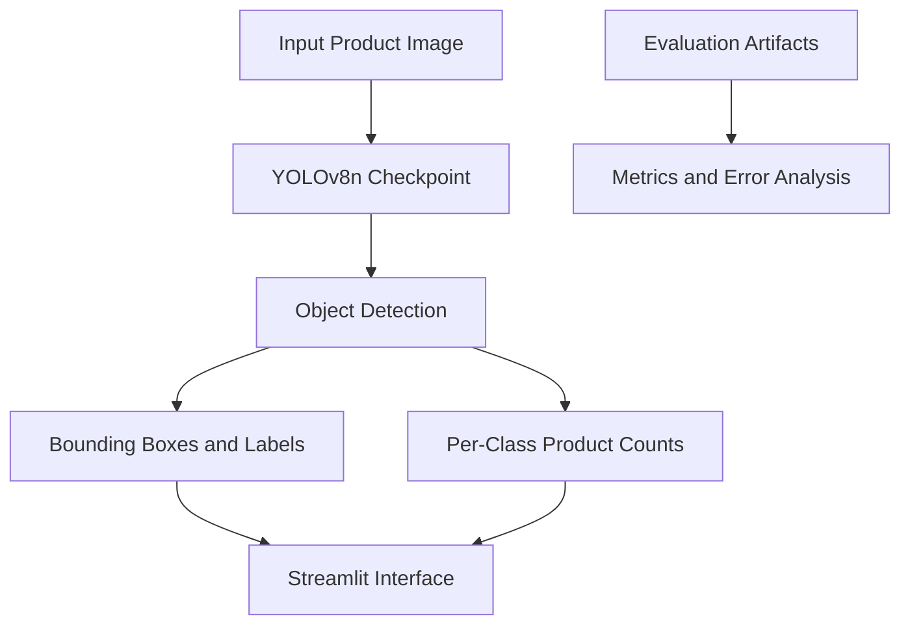

 <div align="center">

# Smart Shelf AI

### Computer Vision for Retail Product Detection & Counting

**Detect. Identify. Count. Evaluate.**

A computer vision project using YOLOv8n to detect and count products in images, with a Streamlit application for inference and evaluation artifacts for analyzing model performance.


</div>

---

## Overview

Retail shelves contain products that can be difficult to inspect and count manually, especially when products look similar or are arranged close together. **Smart Shelf AI** explores how object detection can help automate image-based product recognition and counting.

The project includes a trained YOLOv8n checkpoint, a Streamlit application for image inference, a notebook documenting experimentation, and evaluation files for inspecting model performance and errors.

> **Scope:** The deployed application uses one YOLOv8n checkpoint. Model-comparison results are stored as offline evaluation artifacts; the current application does not run two models side by side.

## Features

- **Image-based inference** — upload an image and run product detection.
- **Object localization** — visualize detected objects using bounding boxes and labels.
- **Product counting** — summarize detections by supported class.
- **Confidence inspection** — review confidence scores associated with predictions.
- **Evaluation analysis** — inspect overall, per-class, per-image, and error-diagnostic results.
- **Experiment documentation** — keep the notebook and evaluation artifacts alongside the application.

## Supported Product Classes

The current model recognizes nine classes:

| ID | Product |
|---:|---|
| 0 | Bournvita |
| 1 | Mysore Sandal Soap |
| 2 | Nivea Body Lotion |
| 3 | Nivea Soft Moisturising Cream |
| 4 | Parachute Coconut Oil |
| 5 | Patanjali Dant Kanti |
| 6 | Society Tea Powder — Plain |
| 7 | Tresemme Hairfall Defense Conditioner |
| 8 | Tresemme Hairfall Defense Shampoo |

## System Architecture



### Workflow

1. Upload an image through the application.
2. The inference module loads the trained YOLOv8n checkpoint.
3. The model predicts objects and their corresponding classes.
4. Predictions are presented with bounding boxes, labels, and confidence scores.
5. Detected products can be summarized by class.
6. Separate evaluation files support analysis of model quality and errors.

## Model Evaluation

The repository contains evaluation artifacts for reviewing model performance.

| File | Purpose |
|---|---|
| `results/overall_metrics.csv` | Overall evaluation metrics |
| `results/per_class_metrics.csv` | Metrics grouped by product class |
| `results/per_image_metrics.csv` | Evaluation details by image |
| `results/error_diagnostics.csv` | Error diagnostics |
| `results/model_comparison.csv` | Offline model-comparison results |
| `results/section15_test_error_analysis/final_test_summary.csv` | Final test summary |
| `results/section15_test_error_analysis/final_test_summary.json` | Machine-readable test summary |

### Interpreting the results

The final test error analysis covers a small sample of **11 images containing 26 labelled objects**. This is useful for examining individual errors, but it is not sufficient to establish performance across all retail environments.

Relevant error categories include:

- Missed detections
- Extra or duplicate detections
- Incorrect class predictions

Similar-looking packaging, occlusion, lighting, camera angle, and image quality can affect detection results.

**Important:** Results from different experiments should only be compared when their datasets, evaluation procedures, and settings are comparable. Consult the corresponding result files for the exact metrics of each experiment.

## Getting Started

### 1. Clone the repository

```bash
git clone https://github.com/kasheeesh08/smart-shelf-ai.git
cd smart-shelf-ai
```

### 2. Create a virtual environment

**Windows PowerShell**

```powershell
python -m venv .venv
.\.venv\Scripts\Activate.ps1
```

**macOS / Linux**

```bash
python3 -m venv .venv
source .venv/bin/activate
```

### 3. Install dependencies

```bash
pip install -r app/requirements.txt
```

### 4. Run the application

```bash
streamlit run app/app.py
```

Open the local URL printed by Streamlit in your browser.

### Model checkpoint

The application expects the trained checkpoint at:

```text
app/yolov8n_9class_v3_best.pt
```

Keep the checkpoint at this location unless you update the corresponding path in the inference code.

## Repository Structure

```text
smart-shelf-ai/
├── app/
│   ├── app.py
│   ├── inference.py
│   ├── requirements.txt
│   └── yolov8n_9class_v3_best.pt
├── notebooks/
│   └── smartShelf.ipynb
├── results/
│   ├── overall_metrics.csv
│   ├── per_class_metrics.csv
│   ├── per_image_metrics.csv
│   ├── error_diagnostics.csv
│   ├── model_comparison.csv
│   └── section15_test_error_analysis/
│       ├── final_test_summary.csv
│       └── final_test_summary.json
├── src/
├── research/
├── requirements.txt
└── README.md
```

Additional files may exist within these directories. Raw datasets and training artifacts are not necessarily included in the repository.

## Notebook and Experiments

The notebook in `notebooks/` documents experimentation and the project workflow. Evaluation files are stored separately so that results can be inspected without rerunning the notebook.

For reproducibility, record the checkpoint, dataset split, confidence threshold, and evaluation settings whenever generating new metrics.

## Limitations

- The model is limited to the nine classes it was trained to recognize.
- Predictions may be affected by occlusion, crowded shelves, lighting, camera angle, and visually similar packaging.
- Detected counts may differ from actual inventory because of missed or duplicate detections.
- Evaluation on a small sample does not establish performance across different stores or real-world conditions.
- The deployed application runs one checkpoint; offline comparison results should not be confused with live, side-by-side inference.

## Future Improvements

- Expand and diversify labelled evaluation data.
- Investigate classes with recurring missed or incorrect detections.
- Improve per-class confidence and error visualizations.
- Compare checkpoints using consistent test data and evaluation settings.
- Explore inventory-oriented workflows after detection reliability has been validated.

## Tech Stack

- **Python** — application and experimentation
- **Ultralytics YOLOv8n** — object detection
- **Streamlit** — inference interface
- **Pandas, CSV, and JSON** — evaluation summaries and analysis
- **Jupyter Notebook / Google Colab** — experimentation workflow

## Contributing

Suggestions and issue reports are welcome. When proposing changes, include enough detail to reproduce the issue. Avoid committing private datasets, credentials, or unrelated generated artifacts.

## Acknowledgements

This project uses the Ultralytics YOLO ecosystem for object detection and Streamlit for the application interface. Refer to the respective projects' documentation and license terms when using or redistributing their software.

---

<div align="center">

**Smart Shelf AI** · Product detection and counting with computer vision

</div>
